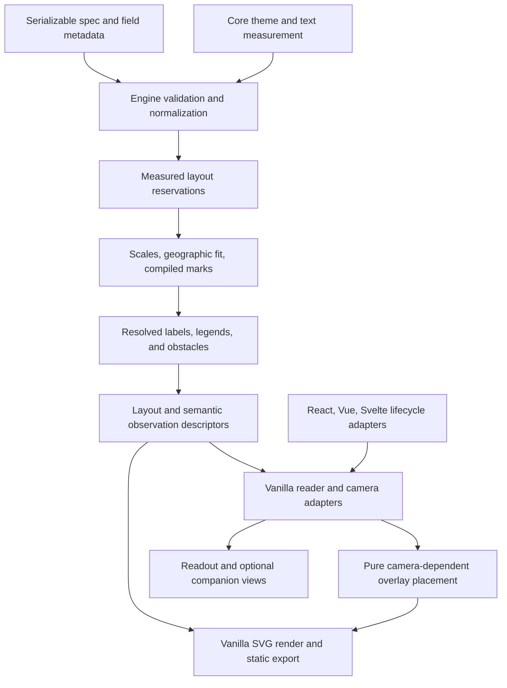

# RFC: Desktop chart craft, reader comparison, and GeoMap design

Status: EXECUTION AUTHORIZED (2026-10-18). Review handoff complete at `93112314`. Implement in the existing `codex/openchart-v9` worktree; commit there. Merge/release remain on hold. B3 candidates still require their concrete before/after review before adoption.
Date: 2026-10-17, revised 2026-10-18
Scope: OpenChart library, framework wrappers, documentation, and gallery only.
Related: [v9 plan](v9-chart-clarity-and-annotation-ux.md), [v9 execution checklist](v9-execution-checklist.md).

## 1. Recommendation and approval boundary

Improve the visual composition of bars, lines, areas, and maps; make geographic identity visible; and build useful comparison experiences on the reader infrastructure already present in v9. Desktop is the primary design surface for this RFC. Narrow containers remain a first-class constraint, not the organizing idea.

Approve a staged program, not one large renderer rewrite. v9.0 is a major release and visual breaking changes are expected in it, so design improvements land as 9.0 defaults when they are genuine improvements. A major is the one window where defaults can change without a compatibility argument; deferring them to opt-in tokens would leave most charts unchanged until v10. Work is split into three buckets:

| Bucket | Contents | Release |
| --- | --- | --- |
| B1: verified bug fixes | Endpoint shared precision and width prediction, endpoint measurement through the host `measureText`, value labels that ignore the theme font, the GDP gallery example's lost precision (§5.2, §12) | 9.0. Each is a correctness fix with a reproducing test. |
| B2: additive opt-ins | Bar `labels.placement`, interior area labels, VL axis title angle/anchor and map side legends (§5.4) are built in P1b/P2 next to the B3 work; map callouts and text channels (P3), reader comparison (P4), detail/insets (P5) | P1b/P2 opt-ins ship in 9.0 if ready, otherwise 9.x; P3–P5 in 9.x minors. Omission reproduces the 9.0 baseline. |
| B3: design defaults | Gridline/zero hierarchy, endpoint spacing and typography, column rhythm and bar row proportions, quieter no-data hatch and border tokens, static map legend polish, size-key placement | 9.0 defaults. Each must show it is an improvement: before/after plates at 390, 1024 and 1440 px in P0, reviewed by the user. A candidate whose plates don't clearly improve on the current output is dropped, not shipped as opt-in. |

Phases still organize the work (P0–P5, §13); the buckets decide when each piece ships. Designs for P3–P5 are included so early choices do not block them. Taking B3 into 9.0 delays it: PR #137 needs a second full baseline review, `migrateSpecV8` gains materializations for the changed defaults, and the annotation invariants rerun. Merge is already paused, and the visual work is the point of this RFC, so that cost is accepted.

This document is a proposal. It does not supersede the binding decisions in the existing v9 plan, authorize changes to PR #137, authorize merging, or authorize publishing. Execution starts only after the user approves this RFC and its phase scope.

The RFC lives in the primary checkout's `plans/` so drafting does not touch the active review worktree. Source observations were rechecked on 2026-10-18 in `/Users/riley/.codex/worktrees/openchart-v9/openchart` at commit `93112314` (branch `codex/openchart-v9`), which added `layout/frame.ts` as the single owner of plot sizing, split `compile/chart.ts` into `compile/*` modules, and moved date-only temporal fields to UTC scales. Symbol names below are more durable than line numbers.

## 2. Product problem, evidence, and success

### Readers and authors

| Person | Job | Current friction | Desired outcome |
| --- | --- | --- | --- |
| Desktop article reader | Understand the finding, then inspect evidence | Inconsistent label placement and formatting compete with the data | Understand units, series, and key comparisons without repeated legend lookup |
| Analyst reading a dashboard | Compare categories or two dates accurately | Hover information disappears; geographic area obscures rank | Keep evidence visible and compare like-for-like quantities |
| Reader unfamiliar with a region | Identify where a finding applies | Unlabeled geography assumes local knowledge | Identify important places without hunting every polygon |
| Library consumer | Ship a polished visualization from a small spec | Some attractive results require local layout/formatting workarounds | Compose documented options without CSS overrides or DOM measurements |
| Author/export consumer | Publish a faithful static chart | Interaction can contain information absent from export | Static labels and explanations survive export; transient state has an explicit policy |

The emotional goal is confidence: the chart should make its evidence legible without implying more precision or certainty than the data supplies.

### Evidence and assumptions

Observed in the current desktop screenshots/gallery:

- Ranked bars alternate between inside/outside values; the population gallery uses a large desktop frame with relatively thin rows. The issue is alignment and proportion, not lack of bar support.
- The GDP endpoint column displayed mixed precision (`5`, `2.80`, `.80`). Root cause, verified 2026-10-18: endpoints already build a whole-field formatter (`resolveFieldFormatter` in `endpoint-labels/compute.ts`), but its context carries no `step`, so `defaultNumberFormatter` falls through to per-value `formatNumber` (integers bare, decimals `,.2f`). Separately, `predictEndpointLabelsWidth` reserves width by formatting only max|v|, which here is the integer `5`, so `0.80` is wider than the reserve; and both predict and compute use `estimateTextWidth` even when the host supplies `measureText`. Those are the clipping candidates. The current gallery story (`examples/src/gallery/charts-line-area.stories.tsx`, "Three Economies") shows a different defect: its axis format `+.0f` wins over the story's `labels.format: '.1f'` (which endpoints never read), so 2.8 renders as `+3`. All of this is B1 bug-fix work.
- Stacked-area endpoint markers can sit at cumulative boundaries while displaying individual series values. A label should identify a band rather than imply that its value is the cumulative y coordinate.
- Overlapping area examples mix several translucent fills. The engine supports restrained alternatives already; gallery guidance matters as much as new options.
- World-map screenshots leave relatively small geography in a wide frame, separated from a top-left legend. Projection aspect ratio and available height are part of the cause; simply stretching the map would be wrong.
- Metro bubbles have a size key, but no persistent city labels. Missing-data hatching already exists and becomes visually dominant in sparsely populated world datasets.
- Existing `createReader` already pins up to two observations. The earlier conversational suggestion to “add persistent comparison” was too broad: the missing work is integrated presentation, domain-slice comparison, map adaptation, and interaction ownership, not generic pin storage.

These are expert observations and user feedback, not a completed usability study. Hypotheses: aligned value columns improve ranking tasks; selective place labels reduce identification time; persistent comparison reduces memory burden. Validate with task-based prototype checks before making the larger interaction features defaults. No analytics or telemetry collection is introduced.

Research informing the proposal:

- [Datawrapper's line-chart guidance](https://www.datawrapper.de/academy/what-to-consider-when-creating-line-charts) supports deliberate focus through color/width, contextual comparison series, and restrained use of point symbols. Our existing capabilities already cover much of this; improve composition and examples.
- [Datawrapper's choropleth guidance](https://www.datawrapper.de/academy/what-to-consider-when-creating-choropleth-maps) distinguishes regional patterns from precise numeric comparisons, recommends labels for unfamiliar geography, and emphasizes understandable color keys. It also distinguishes relative measures suited to choropleths from absolute measures better suited to symbols. We will not infer or transform a measure automatically.

### Acceptance outcomes

1. Every visible value has a clear category/series/place association and an unambiguous unit.
2. No new label, legend, panel, or inset overlaps essential content in the agreed fixture matrix. Constrained layouts use documented fallback or diagnostics, never smaller text as a hidden escape hatch.
3. Explicit author choices and data order remain intact. No automatic sorting, smoothing, aggregation, stacking, geographic exclusion, or chart-type conversion.
4. New optional features reproduce the 9.0 baseline when omitted. The only feature-disabled diffs allowed are B1 bug fixes and approved B3 defaults, each listed by story in the change log (§14).
5. Pointer, keyboard, static export, light/dark themes, and all three framework wrappers agree on identity and meaning.
6. Formative check: at least five representative readers attempt rank, series-identification, geographic-identification, and two-date comparison tasks. Record errors and completion times against current examples. Target at least 4/5 correct unaided answers for each task; this is a release decision aid, not statistical proof. If no readers are available, record that limitation and keep new interaction presentation opt-in.

## 3. Scope and traceability

| ID | Improvement | Phase | Delivery policy |
| --- | --- | --- | --- |
| C1 | Ranked bar value placement, value column, row proportions, row hover | P1 | B2 opt-in placement modes; row proportions B3 |
| C2 | Column label rhythm, grouped/stacked spacing, zero baseline treatment | P1 | B3 (every column chart changes); reuse current marks |
| C3a | Endpoint shared precision, width prediction, host text measurement | P1 | B1 bug fix |
| C3b | Endpoint spacing/typography, leader behavior | P1 | B3 |
| C4 | Stacked-area band anchoring and interior labels | P1 | Band anchors B3 default; interior labels B2 opt-in |
| C5 | Axis/unit/reference hierarchy | P1 | Header titles B2 (VL `titleAngle`/`titleAnchor`); gridline/zero hierarchy B3 |
| C6 | Stable two-date comparison and persistent readout | P4 | B2 opt-in extension of reader/crosshair contracts |
| C7 | Narrow attribution row | Follow-up | Retained in the design program, deferred from the 9.0 chart/map batch. Shared `computeChrome` needs a fixture matrix across chart, geo, table, sankey, barlist, tilemap and graph; caller count alone does not justify dropping it. |
| C8 | Touch inspection persistence, cancellation and dismissal | P4 | B2, same state model as desktop comparison |
| C9 | Value labels use the theme font | P1 | B1 bug fix (bar, column, dot and range hardcode `system-ui`; pie already honors the theme) |
| G1 | Map/legend composition and side legends | P2 | B2; honoring the already-typed side positions changes specs that set them (§5.4) |
| G2 | Place/point labels, geographic callouts, zoom-aware decluttering | P3 | B2: text channels plus authored `callouts` |
| G3 | Legend units, ranges, midpoint, active-value marker, optional distribution | P2/P4 | Static polish B3; active marker/distribution B2 |
| G4 | Persistent map selection and detail panel | P4 | B2, new map adapter, shared reader semantics |
| G5 | Linked ranked list and find-a-place | P4 | B2, optional library companion/controller; no application shell |
| G6 | Obscured-point access, size-key placement | P2/P4 | Size-key placement B3; overlap chooser B2. Paint order unchanged. |
| G7 | Explicit insets and selective detail geography | P5 | B2; depends on projection/feature-layer contract; separate gate |
| G8 | Border hierarchy and quieter missing-data treatment | P2 | B3, with a contrast floor (§5.4) |
| G9 | GeoMap structured diagnostics and extracted map layout | P2 | Prerequisite for every map diagnostic this RFC promises (§6) |

Excluded: OpenStudio, external skill synchronization, map tiles or geocoding services, automatic geographic data downloads, globe/3D maps, new projections, cartograms, point clustering that changes data semantics, bivariate choropleths, arbitrary dashboards, freeform map annotation editing, generic plugin frameworks, release automation, publishing. Small multiples and chart-type recommendations already exist; improve examples where relevant rather than introducing them again.

## 4. Existing architecture and plan reconciliation

| Concern | Existing code / symbol | Reuse and extension |
| --- | --- | --- |
| Package boundaries | `docs/architecture.md` | core → engine → vanilla → React/Vue/Svelte; no upward imports |
| Bar geometry/labels | `engine/src/charts/bar/{compute,labels}.ts`, `computeBarLabels`; column equivalents | Add a pre-layout label budget and placement policy; preserve mark geometry authority |
| Text formatting | `engine/src/format/field-format.ts`, `resolveFieldFormatter`; `core/src/locale/format.ts` | One field context shared by value surfaces, preserving explicit format precedence |
| Endpoint labels | `engine/src/endpoint-labels/{predict,compute,format}.ts` | Prediction reserves width; compute owns final geometry; don't add renderer layout |
| Identification suppression | `engine/src/legend/suppression.ts`, `resolveSuppression` | Keep explicit legend/endpoint truth table, including deliberate dual identification |
| Label collision | `core/src/labels/collision.ts` | Reuse text measurement and rectangle primitives; map candidates need a separate placement policy |
| Plot space (Cartesian) | `engine/src/layout/frame.ts` (`FrameMeasures`, `frameMargins`, `createFrame`), read by `layout/plan.ts` and `layout/budget.ts` | The frame is the single owner of plot-rect reservations. New gutters (bar value column, header titles) become `FrameMeasures` fields so plan and budget see the same plot. `budget.ts` documents the invariant that no reserve is discovered after placement. |
| Axes | `engine/src/layout/axes.ts`, `engine/src/layout/axes/` | Tick and label generation against the frame's plot |
| Map space | `engine/src/geo/compile-geo-map.ts` (inline `fullArea` / `legendBlockHeight` / `mapAreaHeight`) | Does not use the frame. P2 extracts this into `geo/layout.ts` (§6). |
| Metadata/selection | `core/src/types/design.ts` | Reuse `FieldMetadata`, `ReaderObservation`, `ReaderSelection`, `DatasetBinding` |
| Reader controller | `vanilla/src/reader.ts`, `createReader` | Already two pins, keyboard, revision reconciliation; layers currently unsupported |
| Identity/comparison | `engine/src/design/identity.ts` | Reuse `observationKey`, `reconcileReaderSelection`, `compareObservations`, `linkedEntityKeys` |
| Crosshair | `vanilla/src/interactions/crosshair.ts` | Already shared slices/keyboard; replace display-string field guessing before new comparison |
| Maps | `engine/src/geo/{compile-geo-map,join,projections}.ts` | Existing projections, joins, class scale, borders, missing-data patterns, point size key |
| Map presentation | `vanilla/src/{map-renderer,map-mount,map-camera,map-zoom,map-transition}.ts` | Keep mount as camera owner; reuse existing event and lifecycle boundaries |
| Diagnostics/recommendations | `engine/src/design/{diagnostics,recommend}.ts` | Extend structured diagnostics; no compiler logging or automatic spec repair. `compileGeoMap` receives `CompileOptions.onDiagnostic` but never calls it; its warnings go to `onWarn` strings. |
| Theme/export | `core/src/styles/`, existing resolved theme and vanilla export functions | No second color system; static and live geometry share resolvers |

Paths in this table are package-relative under `packages/` unless stated otherwise. Verify exports against the final review branch before adding any.

Open plans:

- [Crosshair explicit tooltip encoding](crosshair-tooltip-explicit-encoding.md): P4 owns the remaining typed role/source-channel work. The older v8 fixes already shipped. Close this plan only after role-based tests cover explicit ordering and duplicate display strings.
- [Multi-layer geo features](requests/multi-layer-geo-features.md): P5 extends its shared projection/fit proposal. The source plan remains open until this phase is approved and delivered. Insets and detail layers are related but distinct: insets have independent views; detail layers share their parent's projection and camera.
- The existing v9 RFC owns annotation editing, stable notes, mark contracts, theme migration, and responsive behavior. This RFC does not relax D1–D19, recreate those systems, or override zero-diff commitments retroactively.
- Completed direct-labeling, default-number-formatting, choropleth, point-layer, responsive, and theming plans are evidence of existing capabilities. Do not reactivate them wholesale.
- No files move to `plans/done/` as part of writing this RFC. Completion is verified against code, tests, docs, and the merged implementation, not inferred from a plan title.

## 5. Design direction and concrete treatments

Choose **editorial clarity with analytical precision**: strong takeaway title, quiet scaffolding, legible values, and color used to explain data. Keep the existing font family and theme system. Use tabular numerals for aligned values, not a new monospace font everywhere. Data palettes remain multicolor when needed; the design skill's single-accent UI advice does not prohibit categorical encodings.

No decorative gradients, glass panels, new shadow system, or rounded chart cards. Existing author gradients remain valid. Controls use the project's current accessible primitives and tokens. Native semantic buttons and inputs are acceptable; do not import a framework-specific icon/control library into vanilla to follow a generic design recipe.

### 5.1 Bars and columns

Ranked horizontal bars can use three aligned zones:

```text
Category                    quantitative plot                 Value
India                       ███████████████████████████       1.43B
China                       ██████████████████████████        1.41B
United States               ███████                           340M
                            0          0.5          1.0B
```

The value column is outside the quantitative scale, within the figure's layout budget. It does not extend bars or replace their baseline. Signed values align in that same value column, with an honest signed zero baseline in the plot. Category order follows the spec, including temporal and user-defined order.

- Proposed `labels.placement?: 'adaptive' | 'inside' | 'outside' | 'column'` (B2). Omission equals current adaptive placement. Validation is per chart type: `column` is valid only for simple horizontal bars with one value per row; `inside`/`outside` are valid for bar and column marks; dot, range and pie reject every explicit placement with a path-specific error, since `LabelConfig` is shared across them.
- `inside` needs new text-fit logic. Today's inside/outside choice is a fixed bar-width threshold (`MIN_WIDTH_FOR_INSIDE_LABEL` in `charts/bar/labels.ts`); only stacked segments get a fit test. `inside` measures each formatted label against its bar, hides labels that don't fit (keeping them in tooltip/accessible data), and never overflows a short bar. It gets its own fixtures. `outside` reserves enough space before scale computation and follows the signed value end.
- `adaptive` keeps current behavior. A per-chart consistent outside placement can be authored without a global flip.
- Row rhythm is a B3 default. Reuse band-scale padding; in auto-height gallery examples, target a 28px row pitch with roughly 16px marks and at least 8px group separation as prototype targets. Respect explicit dimensions and padding.
- `column` mode measures the complete formatted value set once, adds 12px separation, and reserves a right gutter as a `FrameMeasures` field, so the plan and budget both see it. The column/outside/suppress choice is made in the layout plan before placement: value strings, the category gutter and the width are all known there. No re-budget pass. Names wrap at their existing category budget; values do not wrap. If insufficient width remains, the plan falls back as a whole to outside placement and emits a diagnostic; if still infeasible, current density suppression applies, retaining values in accessible data/tooltip. Do not alternate modes row by row. Faceted bars measure the value column at figure level so columns align across panels, the same way the reference lane is shared.
- A labeled value column makes the quantitative axis redundant. Gallery examples using `column` hide the axis and gridlines; the default does not change.
- Row hover is a runtime presentation option, not a spec field. It is spelled in P0 alongside `ReaderPresentationOptions` (§7). Treatment: a very quiet background across category/plot/value zones, with the selected bar outlined. Pointer hit regions must not intercept annotation handles, legends, or editor controls. Keyboard activation targets the same logical row.
- Value labels in bar, column, dot and range marks hardcode `fontFamily: 'system-ui, -apple-system, sans-serif'`, and the renderer writes it as an inline style, so they ignore the theme font every other text surface uses. Fixing that is B1. Pie already threads the theme font and needs only regression coverage. It changes the affected charts with value labels, so it needs a baseline review entry per affected story.
- Columns keep values above positive endpoints and below negative endpoints where space allows. Do not adopt a right value column for vertical marks. Dense categories use existing label-density policies, not rotated value labels or tiny type.

### 5.2 Line endpoints and stacked areas

B1 fixes, verified against the 9.0 branch:

- Shared precision. The endpoint compiler already builds a field-context formatter through `resolveFieldFormatter`; keep it. Pass a shared precision for the displayed endpoint set (the existing `step` field of `FieldFormatContext`, set to `10^-p` where `p` is the largest fraction-digit count among the displayed values, capped at 2) so `2.8`, `0.8` and `5` render as `2.8`, `0.8`, `5.0`. Do this at the endpoint surface only. Changing core `defaultNumberFormatter` would also change bar labels, map tooltips (which call `formatNumber` directly) and ARIA text. Explicit endpoint format still wins, followed by the existing axis/channel precedence.
- Width prediction. `predictEndpointLabelsWidth` formats only max|v|; it must format every displayed value and reserve the widest, so prediction and compute consume the same strings.
- Measurement. Predict and compute use `estimateTextWidth` even when the host supplies `measureText`; both should use the host measure when present, falling back to the estimate.
- Gallery precedence. Endpoints inherit `axis.format` before field context, which is correct when the axis format carries units (`$`, `%`), but the "Three Economies" story's `+.0f` rounds 2.8 to `+3`. Its `labels.format: '.1f'` has no effect on endpoints. Fix the story with `endpointLabels.format: '+.1f'` and drop the dead `labels` field. Precedence does not change.

B3 default for 9.0, subject to the P0 plates: a deliberate endpoint block with series name in the series ink, value in primary/secondary numeric ink, 4px internal gap and 8px minimum separation between resolved blocks. Endpoint sizes are constants today (`ENDPOINT_LABEL_FONT_SIZE` in `endpoint-labels/constants.ts`); moving them to theme tokens changes every multi-series line chart and lands under the v9 theme-schema rules. D4 (no theme knobs solely for migration) applies: the new tokens must be useful design controls in their own right, which also gives `migrateSpecV8` a way to restore the v8 sizes.

- Existing `content`, `width`, `ends`, `format`, `showMarker`, and `showLeader` remain the public controls. No new generic “modern labels” preset.
- Do not use rendered strings to recover raw numbers. Do not unify unlike units across a dual-axis or layered chart, and do not change table/tooltip formatting globally to fix an endpoint-only issue.
- If the endpoint column would leave less than the layout's established minimum usable plot width, use the existing keyed-list/legend fallback where enabled. Preserve explicit suppression choices and issue a diagnostic for impossible fixed layouts.
- Proposed `endpointLabels.anchor?: 'boundary' | 'band'` applies to stacked areas; `band` is the 9.0 default (B3) and `boundary` restores the current behavior. `band` anchors at `(topY + bottomY) / 2` at the corresponding first/last source observation for the leading/trailing column; resolve those independently. It displays the band's own value, not the cumulative sum. Band anchoring is endpoint-only: it does not move the area mark's `dataPoints`, which stay at `yTop` (`charts/line/area.ts`) because hover emphasis, crosshair and transitions read them. The endpoint leader goes from the band midpoint to the label; the crosshair dot stays on the band's top edge, as it does today. Non-stacked line/area marks keep their normal endpoint.
- If series observations end on different dates, label each endpoint with its date or retain a date-qualified readout; do not imply all values share the last global x. Format those dates through the resolved x scale's type (`utc` for date-only fields since 9.0, `time` otherwise) rather than re-detecting the field, or west-of-UTC readers see the previous day while the axis is correct.
- Resolve band geometry from compiled stack data, not interpolation of the rendered SVG path or subtraction of adjacent series in DOM order. Preserve current stack semantics: an absent `(series, x)` row is represented as zero in the pivot geometry, while an explicit row with invalid/missing y creates the existing shared gap. This distinction is implemented in `engine/src/charts/line/area.ts`; P1 does not change it. For an absent row, the point's datum is already the synthetic pivot row (`rowsByXSeries.get(...) ?? d.data`). Observation-presence metadata formalizes that existing distinction as an explicit flag on the point rather than adding a parallel mechanism, so a synthetic pivot datum is never presented as an observed zero. New endpoint/interior labels skip synthetic observations; readers say “No observation” for them even when existing stack geometry uses zero. Changing absent-row semantics requires a separate approved semantic/default-change proposal with its own fixtures and migration policy.
- Area stacks support `zero` (`stackOffsetNone`), `normalize` (`stackOffsetExpand`) and `center` (`stackOffsetSilhouette`). There is no diverging offset for areas; negative values produce inverted bands, whose midpoint is still well defined. For centered (streamgraph) stacks, the band midpoint is the only honest anchor, since the boundaries carry no value. For normalized stacks, endpoint labels default to the existing displayed measure until an approved change is made; explicit share presentation must identify the percent unit, and an authored raw-count value must be identified as raw count with its unit. Never silently label share geometry with an unexplained raw count. Resize may move a label but cannot change its numeric source observation or unit.
- Band anchors use a short leader or bracket rather than a hollow point implying an observed boundary value. If an author explicitly requests `boundary`, preserve the old marker behavior and expose that choice in migration guidance.
- Interior labels are an opt-in `endpointLabels.placement?: 'end' | 'interior'` (default `'end'`), valid for stacked areas and **series-name-only** in P1. They live under `endpointLabels` because they are the same series-identification surface with a different placement, and they fall back to the end column per series; a new top-level `areaLabels` key for one chart type is rejected. Fit the entire text box inside a contiguous band segment using compiled top/bottom bounds. Choose the widest fitting candidate, break ties by last x then stable series key. Fit candidates do not select numerical observations. Values remain at date-qualified endpoints/readouts; if no endpoint values are requested, an interior label does not invent one. If no interior fit exists, retain that series in the endpoint/keyed identification surface. Explicit endpoint configuration may preserve both surfaces; otherwise avoid duplicate series names while retaining separately requested endpoint values. A future interior numeric label requires an authored observation anchor and visible x/date context, not a number chosen by where text fits.
- Overlap, focus, and stacked-composition gallery examples use existing fill opacity and series styles. Do not auto-convert an area into a line or auto-stack data. Maintain missing-observation gaps and the author's interpolation choice.

### 5.3 Axes, units, reference lines, and chrome

Gridline and zero hierarchy is a B3 default for 9.0. It changes every Cartesian chart, so its P0 plates cover line, bar, column, area and scatter in light and dark. Direction: ordinary gridlines recede; zero is recognizable; authored reference lines identify their meaning with attached text. Use existing semantic colors and introduce additional tokens only when a current role cannot express the distinction. Target 1 CSS px for ordinary rules, with contrast rather than thickness providing most hierarchy. Zero emphasis only appears if zero is in the resolved domain; never expand a domain solely to draw it.

Header axis titles (B2) use the Vega-Lite axis properties rather than a new enum: add `axis.titleAngle` and `axis.titleAnchor?: 'start' | 'middle' | 'end'`, next to the existing VL-aligned `labelAngle`, `titlePadding` and `labelPadding`. On a y axis, `titleAngle: 0` with `titleAnchor: 'end'` lays the title out unrotated above the top tick as a header. That placement is OpenChart's documented resolution of those VL properties. The header is a `FrameMeasures` reservation (top band instead of left gutter), so plan and budget agree, and it cannot overlap an eyebrow or endpoint column. Omitting both properties keeps today's rotated title. Explicit titles, tick formatting, grid visibility, reference offsets, and label placement win. Mixed units get separate headers; log axes receive no synthetic zero rule. `titleX`/`titleY`/`titleAlign`/`titleBaseline` are not added until a use case needs them.

The narrow attribution row (source/byline beside a watermark) remains a follow-up in this design program, outside the 9.0 chart/map batch. Its shared core `computeChrome` contract needs a dedicated cross-visualization fixture matrix, including tables, sankey and graphs. That integration cost warrants sequencing, not dropping the reader problem. Keep v9's stable annotation-note band: no resizing in response to temporary hover or drag state.

### 5.4 GeoMap composition and cartographic hierarchy

Compose the title, map, legends, and source as one figure. Support top/bottom legends as today. A side legend uses a measured gutter; it does not imply that a map can grow beyond its height constraint.

`GeoMapSpec.legend` is the shared `LegendConfig`, so `'right'` and `'bottom-right'` already type-check on maps, but `compileGeoMap` silently renders any position other than `'bottom'` at the top. `'top-left'` already has a map-only meaning (the point legend floats inside the map), and the size key is already an in-map `'bottom-right'` overlay. Honoring side positions therefore changes the output of existing specs that set them. That is a fix for silently ignored authored config, shipped with P2 as a documented v9 breaking change with a fixture for each position. Position semantics:

| `legend.position` | Choropleth key | Point color key | Size key |
| --- | --- | --- | --- |
| omitted, `top`, `bottom` | Top/bottom band (today) | Same band (today) | In-map bottom-right overlay (today) |
| `right` (new behavior) | Right gutter, top-aligned | Right gutter, below the choropleth key | Right gutter, last |
| `bottom-right` (new behavior) | Right gutter, same order as `right`, block bottom-aligned | | |
| `top-left` | Top band (today) | In-map overlay (today) | In-map bottom-right overlay (today) |
| `inline` | Top band, with a validation warning that inline legends don't apply to maps | | |

No new position values are added; the set is `LegendPosition` in `core/src/responsive/breakpoints.ts`.

```text
Takeaway title
Measure, year, and geographic coverage

┌───────────────────────────────┬──────────────────────┐
│                               │ Unemployment rate    │
│     geography at honest       │ 2–3  3–4  4–5  5–6%  │
│     projection proportions    │                      │
│                               │                      │
└───────────────────────────────┴──────────────────────┘
Source and coverage notes
```

The gutter holds legends only. The P4 selected-region panel is host-placed HTML (§7): the engine reserves no space for it, and the P2 gutter is sized for legends regardless of whether a panel exists. A host that wants the panel beside the legend places its container there.

- When a side legend doesn't fit, the map layout falls back to the top band and emits a structured diagnostic. That fallback is decided in `geo/layout.ts` before projection fitting, not ad hoc. Do not silently move an explicitly positioned legend in any other case. Default maps keep top placement.
- Auto-height gallery examples may allocate more height to world geography. Fixed-height embeds retain aspect ratio and whitespace when unavoidable. Do not claim a right sidebar inherently enlarges the world map.
- Introduce no automatic removal of Antarctica, overseas territories, or unmatched polygons to enlarge the data region. Preserve the existing Mercator fit policy in `geo/projections.ts`, which excludes features entirely south of -60° from fit bounds while still rendering them if in view; this RFC does not change that behavior. Existing `geo.focus` remains an explicit camera choice. New persistent geographic exclusion requires authored feature selection with disclosed coverage, addressed in P5.
- Interior borders stay quieter than silhouettes. Existing border hierarchy is real; refine its tokens and tests rather than rebuild meshes. Map context should be quietest on symbol maps.
- No-data hatching remains a distinct visible pattern. The hatch exists because a solid neutral is indistinguishable from a diverging ramp's midpoint (redBlue's center is `#f7f7f7`; see the comment above `noDataPattern` in `compile-geo-map.ts`). The quieter hatch (B3 default) must keep a contrast floor: the hatch line stays at least 1.5:1 against both the diverging midpoint class and the lowest sequential class, in light and dark themes. Its acceptance gate is a diverging-ramp, small-feature (county-scale), dark-mode fixture where no-data stays distinguishable from both. Zero retains a valid scale color. Do not conflate no observation, zero, and explicitly excluded geography. If richer missingness statuses are needed, require authored metadata and separate keys; P2 does not infer them.
- Color class boundaries, fills, legends, tooltips, and distribution counts consume the same class-scale descriptor. Do not recompute breaks in the legend renderer.
- Diverging legends show the authored midpoint or zero when the existing scale actually uses it. Include interval inclusivity in accessible text and threshold edge tooltips. Never insert a visual zero label that does not match the scale.

### 5.5 Place labels and geographic callouts

Label sources are explicit. A map should not label every polygon by default. A place name uses theme small/body size, restrained weight, a subtle surface halo only when needed, and no permanent card background. A callout can include a short subtitle and leader; its purpose is explaining the finding.

Data-driven labels use encoding channels, following the spec grammar and Vega-Lite's layered text-on-geoshape pattern. Authored records are reserved for callouts, which explain a finding rather than map a field.

```ts
// GeoMapEncoding (features) and GeoMapPointsLayer (points), both optional:
text?: EncodingChannel;          // the label field, e.g. { field: 'name' }
textPriority?: EncodingChannel;  // quantitative; higher places first. Points default to size.
// Label count is bounded by decluttering and the per-view candidate cap (§11),
// textPriority orders candidates; the safety cap is not an author-controlled top-N filter.
// An exact top-N request needs an explicit selection contract; do not claim otherwise.

type GeoAnchor =
  | { kind: 'feature'; id: string | number }
  | { kind: 'point'; id: string | number }
  | { kind: 'coordinate'; space: 'geographic' | 'source'; x: number; y: number };

interface GeoCallout {
  id: string;
  anchor: GeoAnchor;
  text: string;
  subtitle?: string;
  priority?: number;             // finite; default 0
  minZoom?: number;              // relative to base view; default 1
  maxZoom?: number;              // inclusive; absent = no upper bound
  offset?: { dx: number; dy: number }; // screen CSS pixels
  maxWidth?: number;             // positive CSS pixels; default 240
}
// GeoMapSpec addition, optional:
// callouts?: GeoCallout[];
```

The authored key is `callouts`, not `annotations` or `labels`. Chart specs already use `annotations` and `labels` with different shapes, and `migrateSpecV8` (`engine/src/migration/v8.ts`) walks `current.annotations` without narrowing by spec type; reusing the names would make that walker and any spec-generic helper depend on shapes never colliding. A coordinate-only place name (no data row) is a callout with no subtitle. Required fields apply only when a record is authored. Every callout ID is unique; ambiguous anchors are validation errors. Feature and point IDs are separate namespaces. P5 extends the anchor with an optional view/layer scope while maintaining root defaults. These key names are settled here, before P2 touches the GeoMap schema.

- `geographic` uses longitude/latitude through the current geographic projection. `source` uses coordinates in the primary preprojected topology's coordinate system before the engine's fit transform. Reject a geographic anchor on a preprojected identity map without a valid geographic transform; do not pretend preprojected x/y are longitude/latitude.
- Feature anchors use a deterministic interior point on the largest visible polygon component, excluding holes. A centroid outside a concave polygon is not acceptable. This requires the projected component/ring payload defined below; the existing path/bounds/centroid layout is insufficient. Prefer existing geo primitives where suitable; a bounded interior-point search is justified only after a dependency audit. If no usable point exists, omit the label with a diagnostic or require an explicit coordinate.
- Point anchors and point text labels require `points.key`; feature text labels use the join's feature ID. Duplicate/missing IDs cannot resolve persistent references. Text is plain text, escaped by the renderer. No HTML or inferred place names.
- Place labels try a bounded set of inside/adjacent positions; callouts use measured boxes plus leaders and safe viewport gutters. Treat title, legends, inset frames, controls, and other accepted labels as obstacles. Do not forbid every label from overlapping its own polygon.
- Prioritize callouts (by `priority`), then text-channel labels (by `textPriority`, defaulting to point size), then stable ID; never rely on input order for equal-priority geometry. When a label cannot fit, omit its visual glyph and retain its text in the geographic-label inventory described below. Feature/point tooltips remain available where those marks exist; coordinate-only labels have no implicit tooltip target. When a callout cannot fit, move its complete text to a numbered map note below the plot; keep a small keyed anchor marker where possible. Reserve that note band from authored callout capacity, not transient camera state.
- During a camera gesture, preserve accepted labels' identities, transform their anchors, keep text at constant screen size, and hide boxes that leave the viewport. Recompute deterministic placement at camera settle; coalesce programmatic updates. No independent CSS transform on camera-transformed SVG groups.
- The baseline placement function is stateless for a given camera/spec/viewport. No persistent hysteresis that makes exports depend on how the user reached a view. Keyboard focus/selection may temporarily reveal an omitted place in the readout; it does not force unreadable overlapping labels.
- Map callout drag editing is excluded. Rendering `callouts` on GeoMap does not register them with Cartesian `ElementRef` editors. A later editing RFC must define pointers and transactions explicitly.

**Projected geometry contract.** Add optional `GeoLabelGeometry` records for features referenced by text-channel labels or callouts only. Each record contains canonical feature ID, base-map-frame bounds, a canonical interior fallback anchor, and projected polygon components with separate exterior and hole rings (`{ exterior: Point[]; holes: Point[][] }`). Generate them once using the same projection/clipping/resampling settings as the rendered feature path; preserve component/hole associations through projection cuts. Do not parse SVG path strings or ship all topology to the interaction controller. The pure overlay resolver applies camera transforms, intersects components with the viewport, subtracts holes, and chooses the largest valid visible component by area with stable component-index ties. Use bounded point search with a documented tolerance; an unproven candidate is omitted rather than placed in water or a hole.

Retain rings only for candidate features and measure memory during P3. Initial guardrail: at most 50,000 projected vertices across candidate label geometry per view. Above that, emit a diagnostic and use previously validated canonical anchors for excess candidates, displaying them only while their anchors are in view. Do not truncate a ring or simplify away holes silently. All labels still enter the accessible inventory. This degraded mode explicitly gives up choosing an alternate visible component and is tested separately. Camera gestures use existing accepted anchors; settle/export rerun the same pure resolver from the retained payload. Tests must cover a multipolygon whose largest visible component changes on zoom, a concave polygon with a hole, and identical results reached through different camera histories.

**Accessible label inventory, delivered in P3.** Add engine-resolved records containing the callout ID or the labeled row's key, exact text/subtitle, anchor kind and associated feature/point ID or coordinate, and a visibility reason (`visible`, `collision`, `zoom-range`, `offscreen`, `unresolved`, or `geometry-budget`). Do not substitute a topology name for custom authored text. Include coordinate-only and unjoined-feature labels. Labels outside authored zoom bounds remain in the inventory with “Visible at another zoom level”; zoom bounds control visual density, not information access.

By default the inventory is exposed without changing layout: the map's accessible description points to a visually hidden list (the existing screen-reader-only pattern) containing every entry, so fixed-height containers don't overflow and auto-height containers don't resize. A visible “Map places and notes” disclosure is a runtime option that takes a host-supplied container, the same contract as P4 panels (§7); the renderer never inserts visible DOM outside the measured SVG frame on its own. The list works without P4's reader panel and shows stable IDs and readable visibility explanations. Avoid thousands of tab stops: list entries are text, not separate focus targets unless they have a defined action. Opening it does not resize/refit the SVG or alter camera state. Live SVG accessible description identifies the map and points to the adjacent inventory; it need not repeat every entry. Standalone SVG/SSR exports include the complete authored inventory in their accessible description, including omitted names. A coordinate label is not promised a value unless one was authored as text. P3 browser tests verify the hidden list and the opt-in disclosure are reachable, custom text is present, screen-reader associations survive rerenders, and a fixed-height container doesn't grow.

### 5.6 Reader comparison and map details

Use a fixed readout near the chart/map, with a lightweight cursor preview and persistent pins. Stable layout matters more than animation. The baseline remains readable before any interaction.

Chart journey: move across a line to inspect an observed x; click or Enter to pin date A; move to date B to preview values and eligible changes; click or Enter to retain B. A visible Clear button and Escape dismiss. Show the dates in the readout and draw unobtrusive vertical guides. Two pins stay visible after pointer exit. A third pin replaces B while keeping A; pinning A again removes A and promotes B. This is a new explicitly opted-in slice-comparison mode, not a silent change to the current reader's last-two-observations policy.

Map journey: hover gives a short tooltip; click/Enter pins a feature or point and shows a stable detail panel. Another pin enables a two-place comparison when units/measures permit it. An optional ranked list and local find-a-place input reveal small regions without enlarging their geometry. Search operates only on supplied names/data and requires no geocoder or network.

- Preview, pinning, camera focus, legend emphasis, and author editing are distinct states. Selecting a map region does not automatically zoom; provide an explicit “Show on map” action using the existing camera API.
- Map panel content is name, primary value/unit, and authored supplemental fields. National averages, previous periods, and rank require explicit data/bindings; do not compute an unweighted national rate from region rates.
- Comparison uses raw values and `compareObservations`. Require matching measure, unit, representation, and compatible grouping/transform semantics. Missing metadata shows side-by-side values without a delta and explains why. Percent/proportion differences use percentage points; relative changes at zero are unavailable. Negative-baseline relative changes remain opt-in and explicitly described using the existing absolute-denominator convention. Do not silently change that existing helper's behavior.
- A slice comprises all matching observations at one typed domain x, scoped to a series/layer binding. It is not a fake row or an aggregate. Store typed x values and observation identities; never use rounded pixel x or formatted dates as durable keys. Sparse series show “No observation” at an absent x; no interpolation or carry-forward. Duplicate `(series, x)` values without a declared aggregation are ambiguous and ineligible for delta comparison.
- P4 initially supports a single Cartesian line/area spec with one x channel and a known measure per series. Existing layered-reader rejection stays until explicit dataset binding is implemented and tested. Facets retain panel scope; no cross-panel comparison without a binding. Unsupported cases return an actionable diagnostic and retain normal tooltips.
- Touch tap pins after a successful stationary gesture; scroll, drag, pinch, pointercancel, and editor gestures do not pin. Touch inspection can remain after lift in this opt-in mode. Map pan/zoom keeps current page-scroll semantics.
- Keyboard arrows inspect; Enter pins; Escape clears reader state within the focused reader only. Tab moves between chart, readout controls, list, and search. Edit mode owns its own keys and suspends reader gestures. A map with zoom enabled uses arrows for pan only when its camera control owns focus; feature navigation lives in a separate focus context.
- Readout does not steal focus on pointer selection. `aria-live="polite"` announces settled pin/change/dismiss events, not every pointer frame. Names, values, filtered/deleted states, and comparison direction must be spoken.

### 5.7 Symbol maps, lists, and insets

Keep point centers at their true projected coordinates and symbol area proportional to value. Larger-first paint order and a surface knockout outline already exist in `compile-geo-map.ts`; retain them unchanged. The sort (`pointMarks.sort((a, b) => b.r - a.r)`) is stable, so equal radii already keep data order deterministically; re-tying by ID would reorder paint against author data order, which acceptance outcome 3 forbids. If update transitions need cross-revision stability, that is a transition-key concern, not paint order. Retain authored opacity. Zero, negative, missing, and invalid size values must follow the existing explicit size-scale validation; do not invent visible area for a missing quantity.

An overlap chooser lists the actual hit candidates by stable ID/name and value; keyboard can cycle them. Use screen-space hit testing against displayed radius and camera position. No silent jitter, spiderfying, or clustering that looks like real geography. The existing size legend is refined and placed against occupied bounds; its stale type comment claiming “no size legend in v1” must be corrected in P2.

The linked ranked list is a companion view of the same joined observations, not a new dataset. Sort only when the author enables ranking; ties retain stable ID ordering and disclose tied ranks. Unjoined geographic features can be found by name but have “No data,” not a numeric rank. List filtering is local to that list unless the host explicitly links a filter; hovering the list previews the map, pinning shares reader state. Full keyboard/search access remains available even if the visible list is paginated.

Insets are deliberate separate views with a label, clip, frame, and explicit feature coverage. They do not pretend Alaska and Hawaii share the contiguous map's scale/location. Detail layers are contextual features within a view, revealed above a declared zoom threshold. P5 owns both under the projection contract in section 8; neither is a small styling change.

## 6. Architecture: layout authority and package boundaries



Core owns portable spec/layout/event types, tokens, text metrics, and small geometry primitives. Engine owns domain math, identity, formatting, deterministic layout, and validation. Vanilla owns DOM, events, camera timing, render/export, and reader presentation. Frameworks forward options/events and manage lifecycle. No dependency on OpenStudio, no application state store, no new renderer backend, and no network.

### Layout sequence

1. Validate authored options and preserve their precedence.
2. Resolve formatting contexts and text metrics before reserving gutters.
3. Measure chrome, axes, legends, endpoint/value columns and header titles as `FrameMeasures` reservations in `layout/frame.ts` for Cartesian charts; measure map chrome, legends and callout-note capacity in `geo/layout.ts` for maps.
4. Resolve the quantitative plot rectangle or map viewport; compute scales/projection once for the chosen budget.
5. Emit marks with semantic raw values, observation-presence metadata, keys, stack bounds, projected anchors, and bounded projected-ring payloads for authored geographic label candidates.
6. Resolve labels against final geometry and obstacles. Mode choices that change reservations (bar column/outside/suppress, side legend/top fallback) are made in step 3 from known strings and widths. No re-budget pass: `budget.ts` documents the invariant that no reserve is discovered after placement and fed back through a second compile, and this RFC keeps it.
7. Return the chosen mode, geometry, and diagnostics with the layout. Renderers draw that result without guessing margins.

Cartesian charts extend `layout/frame.ts`: new reservations are `FrameMeasures` fields read by both `plan.ts` and `budget.ts`. Maps get their own `geo/layout.ts`, extracted from the inline layout in `compileGeoMap` (`fullArea`, `legendBlockHeight`, `mapAreaHeight`), with `frame.ts` staying Cartesian. Generalizing `frame.ts` was rejected: it is typed to `NormalizedChartSpec`/`Encoding` and built around axes, gutters and endpoint columns, while maps fit a projection and have none of those, so a shared frame would put map branches into the Cartesian hot path. The two share core `computeChrome` and the spec-agnostic note-band measurement (`noteBandHeight`), not a coordinator. P2's first task is the extraction, with zero visual diff, before any side-legend work.

GeoMap gains structured diagnostics in the same step: `compileGeoMap` already receives `CompileOptions.onDiagnostic` and ignores it. Every map diagnostic this RFC promises (side legend doesn't fit, callout overflow, label budget, geometry budget) is a `DesignDiagnostic` through that channel. Existing `onWarn` strings stay as they are. A new general constraint solver is unnecessary: measured fixed gutters plus bounded candidates cover this scope.

### Proposed modules (names may be adjusted to final repository conventions)

| Module | Responsibility | Must not own |
| --- | --- | --- |
| `engine/charts/bar/label-plan.ts` | Placement mode, formatted labels, value-column width contributed to `FrameMeasures` | DOM or reader state; its own reservation outside the frame |
| Existing `endpoint-labels/` | Shared prediction strings, band anchors, final label geometry | Crosshair state |
| `engine/geo/layout.ts` | Extracted from `compileGeoMap`: map/legend/inset rectangles, side-legend fallback, callout-note reserve, structured diagnostics | Camera event listeners; Cartesian frame logic |
| `engine/geo/labels.ts` | Interior anchors, candidate projected rings, accessible inventory, bounded label/callout candidates | HTML or persistent selections |
| `engine/geo/overlay-layout.ts` | Pure camera + viewport + projected rings to screen label geometry and visibility reasons | Reprojecting/fitting base topology |
| `engine/design/comparison.ts` | Slice assembly, compatibility checks, existing comparison helper | Formatting by parsing display strings |
| Existing `vanilla/reader.ts` plus internal state helpers | Selection lifecycle and reconciliation | Owning chart compilation |
| `vanilla/interactions/reader-arbitration.ts` | One interaction owner per gesture/focus context | Editor transactions |
| `vanilla/reader-panel.ts` | Accessible optional readout/list presentation | Statistical inference or data joins |
| `vanilla/map-reader.ts` | Geo event/identity adapter to shared selection semantics | Casting a GeoMapInstance to ChartInstance |

Extract a shared reader-state helper only when both chart and map adapters use it. Keep geometry/hit adapters specific. Avoid a universal “viz controller” refactor just to support two readers.

## 7. Public contracts, state ownership, and compatibility

### Authoring versus runtime

Spec fields describe durable visual meaning and static composition. Reader enablement, selection state, callbacks, DOM panel hosts, and pointer behavior are runtime options. Do not persist pins into a chart spec or emit `EditTransaction` for reader activity.

Add optional visual fields only after TypeScript, normalizer, runtime validator, JSON schema, generated authoring reference, exports, and examples agree. No loose `Record<string, unknown>` extension bag. New map text channels and `callouts` extend only the GeoMap branch of `VizSpec`; helpers must narrow by visualization kind.

Proposed runtime shape, to be finalized against the reviewed reader API:

```ts
interface ReaderPresentationOptions {
  mode?: 'observations' | 'slices'; // existing default remains observations
  panel?: false | { container: HTMLElement };
  comparison?: 'values' | 'absolute' | 'relative'; // default values
}
// Preserve existing createReader(container, instance, spec, onChange).
// Add an optional fifth options argument; do not change current defaults.
// Add createGeoReader(container, mapInstance, mapSpec, onChange, options?).
```

Expose a discriminated slice selection payload rather than placing synthetic slice objects into `ReaderObservation.datum`. Existing observation callbacks must keep their shape. Prefer overloads where `mode: 'slices'` selects a typed callback/state contract; common readout rendering consumes an internal view model. A slice record includes typed x, revision/binding scope, and member observation IDs. Panel containers are supplied by the host; standalone examples demonstrate adjacent placement without teaching the engine about HTML sizes.

Framework wrappers expose equivalent props/events and cleanup, using the vanilla controllers. React StrictMode, Vue/Svelte reactive updates, and switching modes must not create duplicate listeners or repeated callbacks. Callback replacement should not remount the visualization.

### Ownership rules

- A visualization has at most one active owner of reader navigation: existing mark keyboard navigation, shared crosshair, or persistent reader mode. Enabling the latter suspends overlapping handlers and restores them on destroy.
- Editor activity takes priority, followed by camera manipulation, reader activation, then hover preview. Drag recognition cancels pending clicks. Buttons, links, editable controls, and search inputs are excluded from chart-level shortcuts.
- Pinned state is controller-owned, with explicit programmatic set/clear methods if controlled wrappers require them. Programmatic reconciliation must not echo recursively into host updates; events include a reason (`user`, `data`, `filter`, `programmatic`) and equality guards.
- Map identity uses tagged kind plus typed key. Root feature ID `1` and point ID `1` must not collide; number `1` and string `"1"` follow existing join normalization for lookup but retain a documented canonical key. Reuse the actual join's canonicalization; do not create inconsistent normalization in the adapter.
- Filtering retains a pin with a “filtered” status; deleting its uniquely identified observation clears it with an announcement. Changing dataset, measure, transform, or identity field invalidates incompatible comparisons. Ephemeral ID-less pins clear on data replacement. Mere resizing/theme changes preserve pins.
- Animation displays current geometry while values remain clearly tied to a data revision; do not calculate deltas from interpolated SVG coordinates. Reuse existing `previous` observation handling and settle semantics.
- Unmount/destroy cancels task-owned rAF, listeners, observers, and pending announcements. No callbacks after destruction. Compile failure preserves the last valid view/state and surfaces an actionable error through existing conventions.

### Semantic tooltip contract

Extend `TooltipField.role` additively beyond `'total'` with roles for x, series, and value, plus an optional source descriptor containing field/channel and layer scope. Keep label/value/color for display. Engine-created explicit and default tooltips populate the metadata consistently. Crosshair and comparison select by role/source, preserving author field order. Test cases where a date string equals a value or a series name equals the title must never alter field selection.

An x slice uses raw domain coordinates. Current rounded pixel keys are acceptable only for transient hit proximity, never persistent identity. This requires a compiled observation/slice index, built once per data/layout revision rather than scanning every datum on pointermove.

## 8. Geographic projection, detail layers, and insets

P5 requires a design/implementation spike before its public API is frozen. It must demonstrate Texas counties with Austin detail and points spanning Austin/RGV, plus labeled US insets. This is a phase gate, not an excuse to decide fit behavior while writing the renderer.

Proposed explicit vocabulary:

```ts
// Additions inside geo; omission preserves current first-object behavior.
objectKey?: string;
fitObjectKey?: string; // object in the primary topology; default objectKey
detailLayers?: Array<{
  id: string;
  features: unknown;
  objectKey: string;
  minZoom: number;
  maxZoom?: number;
}>;
insets?: Array<{
  id: string;
  label: string;
  featureIds: Array<string | number>;
  placement: 'bottom-left' | 'bottom-right';
  width: number; // CSS px; measured and validated against the map frame
}>;
```

The initial detail layer is context-only: no independent quantitative encoding, tooltip, or selection. It shares the primary view's fitted projection and camera; adding/removing detail does not refit the map or move points. It must use compatible geographic/source coordinates. Do not silently combine preprojected datasets with incompatible source transforms.

Each inset creates a separate view with its own fit, clip, and camera snapshot, while referencing the same source feature/data identities and color scale. A `GeoViewLayout` owns `viewId`, `viewport`, projected features/points, labels, and projection context. Main-view removal of inset features is explicit through the authored inset declaration and disclosed in its label/coverage description; never drop those features from accessible data. The first implementation supports feature insets from the primary topology, not arbitrary external insets.

Preprojected composite US topology does not contain enough information to recover arbitrary new geographic projections. Support it only for explicit source-space views. A portable Albers USA inset preset must use suitable geographic input, or clearly document its limitations. Do not claim all topologies work with every inset mode.

Geo anchor/event scopes gain optional `viewId` and `layerId` where appropriate. Legacy events for root marks retain their existing fields. Selection identity belongs to the observation; visible highlight geometry belongs to each view. The same observation appearing in two views is one selection with two representations. Events identify the activated view so camera actions target the intended inset.

Inset viewports are static during hover/selection. They reserve layout space before projection fitting. New labels/legends cannot cover their controls or labels. Export serializes every view and clip with unique IDs, including when multiple maps share one document. Focus targets must explicitly name a view when ambiguous.

## 9. Legend distribution, active markers, and linked views

P2 improves existing static legend content and placement. The frozen P4 spelling is `GeoMapSpec.colorKey?: { activeValue?: boolean; distribution?: boolean }`, both omitted/false by default. The existing `EncodingChannel.legend` uses shared `LegendConfig`; extending it with map-only state would broaden unrelated Cartesian channels. Do not ship a second spelling. Selection state remains runtime-owned; this block enables its static key presentation.

Distribution means counts of joined finite feature observations in the existing color bins, one observation per displayed feature, not area or population. Label it “Regions per range” (or author-supplied geography noun). A feature duplicated in an inset counts once. Missing data is counted separately; points use their own independent scale/legend. No implicit weighting, new bins, or recomputed quantiles from a hovered subset.

The active marker uses the same raw value→scale mapping as fills, showing an exact formatted value above/beside the key without changing its reserved size. Clamped out-of-domain values show an edge marker and explicit “outside displayed range” text. No-data regions show their status without pretending to occupy a numeric location. Two pins can show A/B markers plus a textual comparison. Categorical keys highlight the selected category, never invent a continuous position.

The ranked list/search panel uses existing `DatasetBinding`/`linkedEntityKeys` semantics where suitable. Cross-chart linking is explicit and host-owned; no global selection singleton or event bus. A missing binding disables cross-view actions with a diagnostic. List selection must not filter a map implicitly or renormalize its color domain.

## 10. Accessibility, export, internationalization, and failure states

| Situation | Required behavior |
| --- | --- |
| Empty dataset or all values missing | Preserve context/title; show an honest empty/no-data state; no fake zero, rank, delta, or distribution |
| Duplicate IDs or duplicate slice values | Diagnose ambiguity; disable persistence/comparison for affected observations; no first-match guessing |
| Long names, large fonts, narrow frame | Wrap names or switch documented layout; keep minimum readable typography; expose omitted place names accessibly |
| Legend/panel cannot fit fixed height | Preserve explicit size; use documented fallback/scrollable HTML companion; never clip the map silently |
| Feature/point removed | Clear invalid pin/callout resolution with diagnostic/announcement; retain valid others |
| Theme/resize/reorder | Preserve stable identities; re-layout from source geometry; no release jump |
| Reduced motion | Instant camera/label transitions and no entrance effects; equivalent final geometry |
| Editor active | Reader does not intercept selection, drag, Delete, Escape, or arrow keys owned by editing |
| Hover over no-data feature | Place name and “No data”; no misleading numerical tooltip |
| Locale change | Recompute measured strings and gutters; no parsing localized strings back into numbers |

Provide a visible focus treatment independent of palette color. Use at least 4.5:1 text contrast for ordinary small text and 3:1 for meaningful graphical focus indicators against their immediate background. Verify dark themes and authored fills; inaccessible authored colors receive diagnostics rather than silently changing data meaning. Hover-only information must have keyboard and persistent alternatives.

Static SVG/PNG export includes text-channel labels, callouts, legends, note bands, inset frames, and geographic coverage. It excludes transient hover/pins and HTML panels by default. P4 offers an explicit snapshot export option only after defining an engine-resolved readout block; do not screenshot arbitrary host DOM or embed `foreignObject` as a shortcut. Until that option is implemented, document transient-panel exclusion rather than suggesting export parity that does not exist. SSR uses deterministic default camera/label layout without `window` or DOM measurement.

Use existing locale formatting for numbers and dates, preserving explicit authored formats. Test decimal commas, long translated labels, and Unicode minus. Do not claim full RTL support without verifying current framework/theme behavior; add RTL geometry checks for new right/left placement and label clipping and document any existing limitation.

## 11. Performance and lifecycle budgets

Record post-review baseline timings on a named machine before implementation. Proposed budgets are guardrails, not measured claims:

- No whole-spec compile on hover or camera animation frames. Rebuild observation indexes and projected anchors only when their inputs change.
- At 1,000 line observations, reader pointer handling p95 under 8ms; use indexed nearest-domain lookup and process at most once per animation frame.
- At ~3,200 county features, keep camera writes within one frame budget through existing transforms; label placement is bounded and runs on settle. Default authored place-label cap 200 candidates per view; higher requests emit a diagnostic and retain priority-ranked candidates. Callouts are separately budgeted; large authored sets must preserve omitted text in notes.
- Pure label placement target p95 under 20ms for 200 candidates with measured text cached by font/text/width/locale. Cache only within a layout lifecycle; no global cache that leaks documents.
- No frame-time `getBBox()` or `getBoundingClientRect()` reads to infer geometry. Coordinate conversion can use a cached host rect refreshed at layout/scroll boundaries; use existing interaction conventions for zoom and device pixel ratio.
- New work should not add more than 10% compile time to feature-disabled canonical fixtures. Investigate regressions before adjusting budgets. Measure bundle delta per phase with existing checks; do not add a GIS/UI dependency without a recorded size/maintenance tradeoff.
- Cancel/retarget update transitions via existing driver and camera ownership. Ghosts are noninteractive and excluded from hit indexes. New labels follow the existing entrance/update distinction; no CSS transforms that overwrite SVG camera transforms.

## 12. Compatibility and proposed default-change manifest

Every feature-disabled visual change this RFC can produce is listed here, by bucket. Anything not in these tables is opt-in, and a feature-disabled diff outside them is a bug.

B1, bug fixes (no approval of a default needed; each lands with a reproducing test and a baseline entry per changed story):

| Fix | Visible effect | Affected output |
| --- | --- | --- |
| Endpoint shared precision | One precision across the displayed endpoint set (`2.8`, `0.8`, `5.0` instead of `2.80`, `0.80`, `5`) | Multi-series line/area charts with endpoint values, no explicit format, and mixed integer/decimal last values |
| Endpoint width prediction and host measurement | Column wide enough for its widest value; no clipped values | Same charts; also any host passing `measureText` whose fonts measure wider than the estimate |
| Value labels use the theme font | Bar, column, dot and range value labels switch from `system-ui` to the theme font | Affected bar, column, dot and range charts |
| Gallery "Three Economies" story | Endpoints read `+2.8`, `+0.8`, `+5.0` instead of `+3`, `+1`, `+5` | That story only (example change, not engine) |

B2 features that change existing specs: map side legends ship with P2, and specs that already set `legend.position: 'right'` or `'bottom-right'` on a map (silently rendered at the top today) move to a side gutter. The changelog names this, and fixtures cover each position.

B3, design defaults for 9.0. P0 completes this table with the affected story names and before/after plates; the user approves or drops each row on that evidence. Approved rows ship as defaults; `migrateSpecV8` restores the v8 look through the listed path where the spec can express it, and reports the limitation where it can't.

| Default change | Visible effect | Blast radius | v8 look preserved through |
| --- | --- | --- | --- |
| Gridline/zero hierarchy (C5) | Quieter ordinary rules, recognizable zero | Every Cartesian chart | Theme tokens set to v8 values |
| Endpoint spacing/typography (C3b) | Deliberate name/value blocks, collision clearance | Every multi-series line/area chart with endpoints | Theme tokens set to v8 values |
| Column rhythm and zero baseline (C2) | Label rhythm, grouped/stacked spacing | Every column chart | Explicit band padding; zero rule via theme token |
| Bar row proportions (C1) | 28px row pitch targets | Auto-height bar charts | Explicit band padding |
| Stacked-area band anchors (C4) | Endpoint labels sit on the band they describe instead of the cumulative boundary | Stacked area charts with endpoint labels | `endpointLabels.anchor: 'boundary'` |
| Quieter no-data hatch and border tokens (G8) | Data takes visual priority | Every choropleth with missing data | Theme tokens set to v8 values (contrast floor in §5.4) |
| Static legend polish (G3) | Units, ranges, midpoint in map keys | Every choropleth legend | Not preservable; reported |
| Size-key placement (G6) | Size key placed against occupied bounds | Every bubble map | Not preservable; reported |

Bar placement modes, interior area labels, header axis titles, map text channels and callouts, reader panels, distribution strips, selection UI, detail layers, and insets are additive opt-ins. Gallery examples may adopt them without claiming all minimal specs changed.

Do not add a broad compatibility theme that hides behavioral changes. Extend `migrateSpecV8` only for affected old defaults, with fixtures, explicit repair reports, and truthful limitations. A migration cannot preserve an old output exactly if the required override is absent; either add a narrow useful control, keep the change opt-in, or report the limitation for approval. Never silently rewrite authored data, explicit number formats, feature coverage, or projection selection.

Update `docs/migrating-v9.md`, root unreleased changelog, API examples, `docs/codebase-map.md`, generated schemas/references, and all wrappers alongside the phase that changes behavior. New public APIs receive typed positive/negative compile fixtures.

## 13. Implementation sequence and phase acceptance

Execution is authorized in the existing v9 worktree, with subsystem ownership and serialized commits on `codex/openchart-v9` (user instruction overrides separate branches/PRs). Review handoff is complete. B3 visual adoption and P5 spike gates remain concrete evidence gates; no merge is authorized.

### P0 — Reconcile and establish design evidence

- [x] Confirm final PR #137 state and source symbols against `93112314` or its successor. PR remains open at `3585ecb3`; local `93112314` descends from it and contains the completed review handoff.
- [x] Reconcile existing plan statuses and the reader/layout changes already delivered.
- [ ] Produce before/after plates for every B3 row (§12) at 390, 1024 and 1440 px, light and dark, plus 200% text checks: desktop bar, column, line, stacked area, choropleth and bubble map. The user approves or drops each B3 row from these plates; this is the "genuine improvement" gate.
- [ ] Spell the B2 APIs (`labels.placement`, `endpointLabels.anchor`/`placement`, `axis.titleAngle`/`titleAnchor`, map `text`/`textPriority`/`callouts`) and the runtime options for row hover and the inventory disclosure, alongside `ReaderPresentationOptions`.
- [x] Hard gates before P2: map layout lives in an extracted `geo/layout.ts` (§6, decided), GeoMap emits `DesignDiagnostic` through `onDiagnostic` (decided), and P4 panels are host-placed with no engine reserve (§5.4, decided). P0 confirms each still holds against the final branch.
- [x] Capture performance/bundle baseline and use concrete examples for reader tasks. Formative user study remains a later reader acceptance task; no measured usability claim is made.

Acceptance: every B3 row is approved or dropped on its plates, and approved rows have a v8-preservation path or a reported limitation; B2 spellings are frozen; P0 is validation, not permission to merge implementation. No public API should be invented solely to make a single screenshot fit.

### P1a — Bug fixes (B1)

- [x] Endpoint shared precision through `FieldFormatContext.step`, endpoint surface only. Test: last values `2.8`, `0.8`, `5` render at one precision; explicit `endpointLabels.format` and axis format still win.
- [x] `predictEndpointLabelsWidth` formats every displayed value. Test: max|v| is an integer and a smaller decimal is wider; predicted width equals compute's width.
- [x] Endpoint predict and compute use the host `measureText` when supplied.
- [x] Value labels in bar, column, dot and range marks now use the resolved theme font; pie already did. Test asserts the label style's `fontFamily` equals the theme's; baseline entries per changed story.
- [x] Fix the "Three Economies" gallery story's endpoint format and remove its dead `labels` field.

Acceptance: each fix has a test that fails before it; every changed baseline is listed with its story and fix; no other feature-disabled diff.

### P1b — Desktop chart craft (B3 defaults; B2 opt-ins)

- [x] Test first: placement modes, signed/zero bars, measured gutters, all labels too wide, explicit sizing, per-chart-type placement validation, unsupported grouped/stacked column mode, faceted column alignment, `inside` text fit.
- [x] Add the bar value column as a `FrameMeasures` field with the column/outside/suppress choice in the layout plan; `inside` text-fit logic.
- [x] Add `endpointLabels.anchor: 'band'` (endpoint-only, `dataPoints` unchanged) and `endpointLabels.placement: 'interior'`; date qualification through the resolved x scale type.
- [x] Add `axis.titleAngle`/`titleAnchor` with the header reservation in `FrameMeasures`.
- [ ] Ship the approved chart B3 defaults: gridline/zero hierarchy, endpoint spacing/typography, column rhythm, bar row proportions, band anchors. Add their theme tokens and `migrateSpecV8` materializations of the v8 values, with fixtures showing a migrated v8 spec keeps its v8 look.
- [x] Add focus/overlap/composition gallery examples and update docs.
- [x] Validate zero/normalize/center stacks, absent series rows versus explicit null/nonfinite/true zero, both endpoint columns, mixed units, facets, and layers. Assert synthetic pivot geometry never becomes an observed label value and resize never changes numeric provenance.

Acceptance: feature-disabled fixtures match the post-P1a baseline except the approved B3 rows, each with a baseline entry per changed story; labels preserve the correct source value and associated mark; no type/legend conversion occurs automatically. Annotation drag and stable-note invariants still pass.

### P2 — Map composition, legend, and symbol craft

- [x] Extract `geo/layout.ts` from `compileGeoMap` with zero visual diff; route new map diagnostics through `onDiagnostic`.
- [x] Test first: top/bottom/right/bottom-right legend budgets, side-legend fallback with diagnostic, fixed-height aspect ratio, multiple point/color/size keys, no-data versus zero, class-boundary labels.
- [x] Implement side legends per the §5.4 position table; changelog entry for specs that already set side positions.
- [ ] Ship the approved map B3 defaults: static legend polish, size-key placement, and quieter no-data/border treatment with the §5.4 contrast floor. Theme tokens and `migrateSpecV8` materializations where expressible. Paint order unchanged.
- [x] Correct the stale “no size legend in v1” type comment.
- [x] Keep feature coverage/projection/fit semantics unchanged; no automatic map crop.
- [x] Add desktop world, US categorical, county, diverging, sparse-data, and bubble comparison plates.
- [x] Freeze the single public opt-in spelling for P4 active/distribution legend configuration.

Acceptance: map scale and color bins match legend values exactly; legends clear points/chrome; no geometry distortion; feature-disabled mode matches the baseline except approved B3 rows and specs that set side positions.


### P3 — Geographic labels and callouts

- [ ] Test first: feature/point/source/geographic anchors; concave/multipolygon interior points; preprojected rejection; stable IDs and duplicate errors.
- [ ] Add typed spec/normalization/validation, bounded projected-ring records with hole/component associations, canonical fallback anchors, and the accessible label inventory.
- [ ] Implement deterministic camera-dependent label placement, callout leaders, the callout-note reserve in `geo/layout.ts`, and bounded decluttering.
- [ ] Add constant-screen-size rendering, zoom visibility thresholds, camera-settle reconciliation, and lifecycle cleanup.
- [ ] Verify static export/SSR and multiple maps' clip/pattern ID isolation.
- [ ] Test alternate visible multipolygon components, holes, geometry-budget fallback, coordinate-only labels omitted by collision, custom versus topology names, unjoined features, and zoom-hidden inventory entries. Verify the P3 disclosure works without enabling P4.
- [ ] Add GeoMap API/docs/wrapper coverage; explicitly exclude annotation editing.

Acceptance: names remain attached through camera movement; no text jumps due to a second projection fit; callout content is never lost when moved to notes; same spec/camera/size gives the same exported placement regardless of interaction history.

### P4 — Reader comparison and map exploration

- [ ] Land role/source metadata for crosshair fields and close the remaining crosshair plan only after tests.
- [ ] Test typed slice keys, duplicate x ambiguity, sparse series, metadata compatibility, percent-point math, zero baseline, filtered/deleted/reordered pins.
- [ ] Extend existing reader with opt-in slice mode; preserve old observation-mode API/behavior.
- [ ] Add the GeoMap reader adapter with canonical join identity and selection outline.
- [ ] Implement fixed readout, local search/ranked companion, overlap chooser, active legend markers, and optional distribution counts.
- [ ] Integrate pointer/keyboard/camera/editor ownership and touch cancel/no-pin paths.
- [ ] Add matching wrapper lifecycle/controlled-state tests and accessibility checks.
- [ ] Implement explicit snapshot-readout export only with a portable layout; otherwise leave the feature excluded and clearly documented.
- [ ] Run formative reader tasks; record limitations instead of claiming untested usability gains.

Acceptance: a reader can compare two dates or places without remembering a vanished tooltip; no conflicting gesture fires twice; raw identity/value semantics survive data updates; unsupported bindings never display invented deltas. New interaction remains opt-in.

### P5 — Detail geography and intentional insets

- [ ] Prove fixed shared fit with Texas/Austin/RGV fixture and valid preprojected/geographic input contracts.
- [ ] Finalize view/layer scope and event compatibility before implementation.
- [ ] Add object selection, fixed fit object, contextual detail layers, and explicit inset views.
- [ ] Test point positions are unchanged when context detail becomes visible; test inset coverage/scale labels and shared observation selection.
- [ ] Verify focus, clipping, dark theme, label decluttering, SSR/export, and multi-map IDs in each view.
- [ ] Update and close the open multi-layer geo request only when its actual Austin use case passes.

Acceptance: detail context never changes primary projection fitting; insets are explicitly labeled separate views; no feature/data disappearance or ambiguous camera target. P5 remains a separately approved follow-up.

## 14. Verification and visual change control

For every source implementation phase:

```sh
bun run test
bun run lint
bun run typecheck
bun run build
bun run check:generated
bun run test:visual
bun run test:invariants
bun run check:boundaries
bun run check:library-bundle
```

Run generators when spec/theme types change. Run script tests when scripts change and relevant performance tests for interaction/geometry work. Existing annotation-invariants projects remain intact and run for any shared layout/interaction change; inspect actual project names in the final branch rather than inventing them. New chart/map design invariants belong in a separate suite without weakening existing tests.

Fixture matrix:

| Dimension | Cases |
| --- | --- |
| Width | 320, 390, 768, 1024, 1280, 1440 CSS px; include narrow dashboard cards on wide viewports |
| Height | Auto, 200, 400, 600; existing cramped/minimal heights retained |
| Theme/text | Light, dark, authored background/fill, large font/200% zoom, long labels, decimal-comma locale |
| Bars/columns | Positive/negative/mixed/zero, long names, many rows, group/stack, fixed order, explicit padding/format, faceted value columns |
| Lines/areas | 1/3/8+ series, clustered endpoints, sparse dates, gaps, normalized/diverging stacks, layer/facet scopes |
| Maps | US/world/county, categorical/sequential/diverging, all/sparse/no data, tiny/concave/multipart features, preprojected input, every `legend.position` value |
| Symbols | Overlap, equal radii, duplicate/missing keys, independent color+size scales, points near clips |
| Interaction | Pointer/keyboard/touch, reduced motion, update interruption, editor conflict, search/panel focus, pan/zoom cancel |
| Output | Live SVG, SSR SVG, SVG-with-fonts, PNG/JPG, multiple figures in one page |

Use pairwise combinations for broad coverage plus targeted full combinations for known risks; do not create thousands of redundant screenshots. Semantic geometry assertions test association, bounds, non-overlap, identity, scale/legend agreement, and event counts. Browser tests verify behavior; visual baselines verify intentional appearance. Do not write snapshots that merely mirror the implementation's own calculations.

Follow `.claude/rules/visual-verification.md`: use the playwright-cli skill, `?mode=preview`, wait for fonts/render completion, and inspect chrome, y-axis, x-axis, plot, legend, and all edges. For maps add geographic coverage, border hierarchy, labels/callouts, insets, controls, and readout zones. Review at 390 and 1280 minimum; desktop design acceptance also requires 1024 and 1440 captures.

Every changed baseline gets an entry naming the story, before/after image, intended change ID, and acceptance result. Feature-disabled diffs outside the approved manifest are bugs. Baselines are updated only after manual verification of deliberate changes; never run update to erase an unexplained diff. Respect platform-specific baselines. Export and reduced-motion final state must match the same resolved geometry.

## 15. Alternatives, risks, and decision log

| Decision | Chosen approach | Alternative rejected / tradeoff |
| --- | --- | --- |
| Broad visual improvement | Small chart/map-specific policies atop existing layout | Global “modern theme” cannot fix semantic association or interaction |
| Bars | Optional aligned value column, honest quantitative scale | Always-inside labels fail short/negative bars; fixed per-row offsets are brittle |
| Area identity | Band anchors and optional fit-tested interior labels | Cumulative boundary dots misrepresent individual-band values |
| Reader state | Extend existing identity and selection contracts | A second pin store would disagree on updates and wrappers |
| Map labels | Authored candidates and bounded deterministic placement | Labeling every feature creates noise; force simulation complicates export and stability |
| Geographic context | Fixed base projection plus explicit views/detail | Swapping fit geometry moves points and breaks geographic continuity |
| Map exploration | Optional local companion tied to supplied data | Geocoding/tiles and a full app shell exceed library scope |
| Rollout | B1 bug fixes and approved B3 design defaults in 9.0; P1b/P2 opt-ins in 9.0 if ready; P3–P5 in 9.x | Shipping the retunes as opt-in tokens until a later major would leave most charts unchanged until v10. The cost of 9.0 (a second baseline review, migration materializations, rerun invariants, a later release) is accepted because the visual work is the point of this RFC. |
| Map layout | Extract `geo/layout.ts`; `frame.ts` stays Cartesian; share `computeChrome` and `noteBandHeight` | Generalizing `frame.ts` to maps puts projection-fit branches into the Cartesian frame |
| Bar mode fallback | Decided in the layout plan before placement | A post-placement re-budget pass breaks the `budget.ts` invariant |
| Map label surface | `text`/`textPriority` channels plus authored `callouts` | Authored `labels`/`annotations` records reuse chart keys with different shapes and don't scale to data-driven labeling |
| Axis header | VL `titleAngle`/`titleAnchor` | A new `titlePlacement` enum diverges from Vega-Lite |
| Interior area labels | `endpointLabels.placement: 'interior'` | A top-level `areaLabels` key for one chart type grows the spec surface |
| Point paint order | Unchanged (stable sort keeps data order) | Stable-ID ties reorder paint against author data order |
| Label inventory | Visually hidden list by default; visible disclosure via host container | Inserting visible DOM outside the SVG overflows fixed-height containers |

Primary risks are scope expansion, inconsistent identity across maps/series, layout feedback loops, and attractive but misleading numeric/geographic defaults. The mitigations are explicit phase boundaries, domain-based identity, bounded geometry passes, shared semantic descriptors, and visual/migration manifests.

Assumptions requiring validation: aligned columns help actual ranking tasks; more map height is acceptable to hosts; 200 candidate labels covers practical editorial maps; caller-supplied panel containers are ergonomic in all wrappers. These are not claims about existing user demand. P0/P3/P4 validation can change their implementation without reopening the core package boundaries.

Decided 2026-10-18 by the user: v9.0 is a major release and visual breaking changes are expected, provided they are genuine improvements. Execution of the program is authorized. Pending user decisions: approving or dropping each B3 row from its P0 plates and the separately specified P5 geometry spike. Release staging of P3/P4 into 9.x is not cancellation of that authorized work. No decision here authorizes merge/release. Remaining API spelling/spike gates are called out in P0/P5 and must be resolved before those contracts ship.

## 16. Adversarial review and disposition

Reviewed on 2026-10-17 by an explicitly dispatched `ce:devils-advocate` agent following [the agent instructions](/Users/riley/.claude/plugins/marketplaces/claude-essentials/plugins/ce/agents/devils-advocate.md). The reviewer inspected the RFC, related plans, and active v9 source read-only. Its assessment supported the architecture and phasing while identifying the substantive gaps below. A focused follow-up verified all five resolutions and found no remaining consequential architectural or semantic blocker. This is review of the proposal, not implementation validation.

| Finding | Resolution | Verification |
| --- | --- | --- |
| R1: Interior area values have no defined observation; leading endpoints were described as trailing | P1 interior labels are name-only. Leading/trailing endpoints independently resolve first/last source observations, date qualification, and units; resize cannot change numeric provenance. | Required P1 fixtures specified for provenance, normalized units, and both ends. |
| R2: “Missing means gap” silently changes existing absent-series zero-pivot behavior | Preserve absent-row versus explicit invalid-row stack semantics. Add observation-presence metadata; synthetic pivot rows never become observed labels or comparison values. Semantic changes require separate approval. | Absent/null/nonfinite/true-zero fixtures specified in phase acceptance, with an explicit manifest boundary. |
| R3: Camera-dependent interior anchors need polygon geometry absent from current layout | Specify candidate-only projected components/exterior/hole rings, camera-time clipping, vertex budget, canonical fallback, and pure deterministic placement. | Multipolygon/hole/history/memory-budget tests specified in phase acceptance. |
| R4: Decluttered coordinate/custom labels have no guaranteed accessible fallback | P3 adds exact authored-text inventory with visibility reasons, an independently accessible disclosure, and standalone export descriptions. It does not depend on P4 or promise nonexistent coordinate tooltips. | Coordinate-only/custom/unjoined/zoom-hidden tests and disclosure checks specified in phase acceptance. |
| R5: Bubble paint order and knockout outline already exist | Reframed P2 as stable tie handling, legend placement, and documentation refinement; keep existing behavior. | Require intentional equal-radius diff review. |

Self-audit also corrected the axes module path, acknowledged existing field-context formatting, and preserved existing Mercator polar-fit behavior. At the first adversarial review, no source implementation or PR changes had been made. The user subsequently authorized execution; the current handoff and remaining evidence gates are recorded below.

### Second review, 2026-10-18

A second `ce:devils-advocate` pass reviewed design and architecture against commit `93112314`, after the frame/budget refactor. The main session spot-checked its code claims before revising this RFC: the stable point sort, the silent map legend mapping, `defaultNumberFormatter`'s per-value fallback, `predictEndpointLabelsWidth`'s max|v| sample, the `budget.ts` invariant, the hardcoded label fonts, the area stack offsets, `compileGeoMap`'s unused `onDiagnostic`, and the eight `computeChrome` callers. The main session also compiled the GDP data and found the gallery story's `+3` rounding, which the reviewer had not reported.

| Finding | Resolution |
| --- | --- |
| Default-change manifest omitted gridline hierarchy, column rhythm, legend polish, size-key placement and the label font | §12 lists every feature-disabled change by bucket; design changes are B3 9.0 defaults gated on P0 plates; the label font is a B1 bug fix across four chart types (pie already honors the resolved font) |
| G6 stable-ID ties contradict outcome 3 | Dropped; paint order unchanged |
| GeoMap doesn't use frame/budget or structured diagnostics | `geo/layout.ts` extraction and `onDiagnostic` are P2 prerequisites, decided in §6 |
| Endpoint formatting mis-diagnosed as a default change | Reclassified as B1 fixes: shared precision at the endpoint surface, full-set width prediction, host measurement |
| Layout step 6 allowed a re-budget pass | Removed; mode choices happen in the plan; value column is a `FrameMeasures` field |
| Quieter hatch reintroduces midpoint confusion | Contrast floor and diverging/small-feature/dark fixture gate (§5.4) |
| Side legend isn't additive | Position table and changelog entry (§5.4, §12) |
| `titlePlacement` not Vega-Lite | Replaced with `titleAngle`/`titleAnchor` |
| Top-level `areaLabels` | Folded into `endpointLabels.placement` |
| Geo `labels`/`annotations` reuse chart keys | Text channels plus `callouts` |
| P4 panel vs P2 gutter | Panels are host-placed; the gutter holds legends only |
| P3 disclosure changes host layout | Hidden list by default; visible disclosure is host-placed |
| Attribution row touches eight compile paths | Deferred from the 9.0 chart/map batch (C7), retained as a cross-visualization follow-up; caller count alone is not a reason to drop it |
| Endpoint typography via theme metrics | B3 9.0 default; tokens must be real design controls under D4 |
| Release cost of P1/P2 in 9.0 unstated | Stated in §1 and accepted. An earlier revision of this pass moved the design defaults to 9.x opt-ins; the user overruled that on 2026-10-18 (major release, visual breaking changes expected), so they are 9.0 defaults gated on before/after evidence. |
| `inside` needs new fit logic; band anchors vs `dataPoints`; no diverging area offset; date qualification after the UTC change | Stated in §5.1 and §5.2 |
| Stale references | Commit, frame ownership and map space rows updated in §1 and §4 |


### Orchestrator audit and execution handoff, 2026-10-18

The user confirmed review completion and authorized GPT-6.1 Sol agents to implement directly in the v9 worktree. The second review improves correctness and architectural fit overall: shared frame ownership, actual endpoint-format failure mechanisms, map-specific layout, preservation of authored bubble order, and host-owned visible panels all have concrete code evidence. Keep those changes. API consolidation is useful only if it preserves the reader outcome; interior labels retain their full fallback and source-value requirements.

Two scope interpretations are corrected:

- P3–P5 remain in the authorized design program. Their 9.x release staging is not cancellation or permission to silently omit them. Deliver the 9.0 foundations first and retain the explicit P5 geometry spike. The current dispatch starts P1/P2; later dependent work follows contract stabilization.
- C7 is deferred from the 9.0 chart/map batch, not rejected. Eight callers justify a dedicated cross-visualization fixture matrix, not abandonment of the narrow attribution problem. Track it as a follow-up covering chart, map, table, sankey, barlist, tilemap and graph paths, respecting stable note capacity. No narrow special case in the shared chrome function.

Residual inconsistencies corrected: the public-contract paragraph now uses text channels/`callouts`; the label candidate safety cap no longer claims it can select exactly ten metros. B1 correctness fixes and additive features may proceed while B3 plates are prepared. No default is dropped merely because it costs implementation effort or changes many screenshots.

Implementation evidence: `FieldFormatContext.step` alone trims integral trailing zeros, so the endpoint-only shared precision resolver also supplies a fixed format for ordinary non-compact numbers. Global number formatting remains unchanged. A further B1 defect was reproduced: vertical value-label sign was inferred by parsing formatted text; Unicode-minus/custom unsigned formats could put negative labels above the mark. Use the raw source number on this surface, with regression coverage and a manifest entry.


### Implementation evidence checkpoint

- Three GPT-6.1 Sol agents implemented bar/column placement, endpoint/area semantics, and map layout directly in the existing v9 worktree. No disposable worktrees were created.
- B1/B2 implementation includes measured labels, optional unit headers, explicit band/interior placement, map side gutters, precise map scale descriptions and useful theme roles. B3 defaults have not been adopted.
- Test-first/browser work additionally exposed and fixed enlarged adaptive values overlapping categories, rotated title glyph ascent clipping, top point keys painted in the wrong band, wrapped key rows under-reserved and bottom key heights double-counted. These are correctness fixes, not blanket visual retunes.
- A first continuous hatch prototype was rejected because it made dark maps busier. A revised separated-stroke candidate is retained for comparison with an explicit small-feature limitation. Static legend and size-key prototypes must also pass measured 200% text layout before adoption.
- 144 chart comparison plates cover six treatments, 390/1024/1440, light/dark, 100/200% text. They compare actual auto-height behavior for row proportions. An earlier fixed-height row comparison was replaced because it could not justify an auto-height default.
- Proposed decisions: grid/zero hierarchy and band anchors improve reading; blanket endpoint-gap, bar-thickness and column-padding retunes do not show a consistent benefit. This is an evidence-based recommendation, not a scope cut. Bar placement, value columns, unit headers and interior labels still ship as additive capabilities.
- Interactive review: `/Users/riley/.codex/visualizations/2026/10/18/openchart-design/index.html`. Baseline review evidence is in its `regression-review/manifest.json`; the original v8 corpus remains unchanged, with narrowly guarded before/after exceptions for proven fixes.


### Verified foundation handoff

P1/P2 foundations are committed on the existing v9 branch as `9be168d9`. The required code reviewer approved the full foundation diff and subsequent signed-stack/legend/capacity/performance corrections. Final results: 7,919 unit tests passed (three intentional expected-failure cases), 115 visual checks, 177 general browser checks (11 platform skips), 106 annotation checks; lint, typecheck, build, generated files and package boundaries passed. The original v8 capture is unchanged. See [the execution record](desktop-chart-and-geomap-execution.md) for exact gate, baseline, performance, cleanup and remaining-work details.

B3 adoption, the row-hover runtime contract and implementation, P3/P4, the P5 spike, and C7 follow-up remain open. No merge or release is authorized by this checkpoint. The review improved architecture and semantic correctness; release staging and integration cost have not been used to remove the broader reader/design outcomes.
